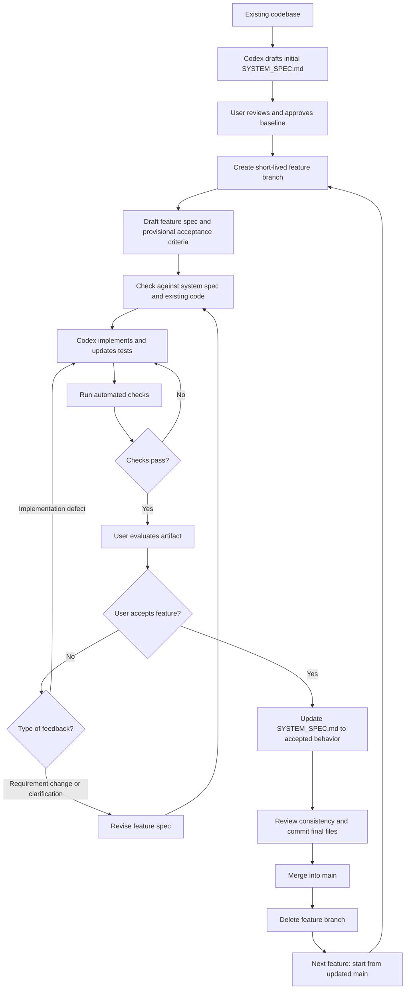

# Framework-less specification-driven development with Codex

## 1. Purpose and scope

This guide describes a practical specification-driven development (SDD) workflow for an existing software project using **Markdown files, Codex, automated tests, and Git**, without Spec Kit, OpenSpec, Kiro, or another SDD framework.

The method combines two kinds of specifications:

- A **system specification** describes the currently accepted, intended behavior and major constraints of the software. It evolves as completed changes are accepted.
- A **feature (or change) specification** describes one proposed development or refactoring task. It is refined during implementation and user evaluation, then retained as a historical record.

A specification guides work; it is not proof that the software meets its requirements. Automated tests, inspection, and user acceptance provide evidence of completion.

## 2. Repository structure

A minimal layout is:

```text
project/
├── AGENTS.md
├── docs/
│   └── specs/
│       ├── SYSTEM_SPEC.md
│       ├── forecast-publishing.md
│       └── forecast-visualization.md
├── src/
└── tests/
```

- `AGENTS.md` tells Codex how to use and maintain specifications. Codex must have access to this file and follow its instructions; the mere presence of Markdown files does not enforce a workflow.
- `SYSTEM_SPEC.md` describes accepted system capabilities, key interfaces, invariants, and constraints. It is the authoritative *requirements* reference, not necessarily a complete account of implementation details.
- Each feature specification describes the motivation, affected behavior, constraints, provisional acceptance criteria, and any implementation plan that is useful for that change.
- `src/` and `tests/` represent the implementation and its automated checks; actual projects may organize them differently.

For a small project, one system specification may suffice. If it becomes unwieldy, divide it into linked subsystem specifications rather than keeping redundant copies.

## 3. Establish the initial system specification

For an existing codebase without a system specification:

1. Ask Codex to inspect source code, tests, configuration, and existing documentation.
2. Have it draft `docs/specs/SYSTEM_SPEC.md` describing observed functionality, interfaces, architectural constraints, and known dependencies.
3. Require evidence for important claims (for example, relevant files or tests) and explicit marking of uncertainties.
4. Review the draft. Distinguish **observed behavior** from **intended behavior**: defects and accidental behavior should not automatically become requirements.
5. Correct and approve the baseline. Commit it once it is useful and sufficiently reviewed.

Reverse engineering cannot reliably reconstruct design intent from source code alone. The initial specification may be incomplete; improve it when relevant parts of the system are examined or changed.

## 4. Develop a feature on a short-lived branch

For each substantial feature or refactoring task:

1. **Create a feature branch** from the current mainline, for example `feature/forecast-visualization`.
2. **Draft a feature specification** in `docs/specs/`, with a clear objective, affected interfaces, constraints, and known acceptance criteria. Criteria can be provisional if the artifact must be assessed interactively.
3. **Review consistency** with `SYSTEM_SPEC.md` and relevant source code. Resolve conflicts with existing requirements or record approved exceptions before proceeding.
4. **Plan and implement** with Codex. Ask it to write or update tests where appropriate, and keep the feature specification aligned with agreed requirements.
5. **Run automated checks** and inspect their results. Passing tests is necessary when tests apply, but is not equivalent to user acceptance.
6. **Evaluate the artifact yourself**, including exploratory or visual testing that could not be specified fully in advance.
7. **Classify feedback**:
   - **Implementation defect:** The code fails an existing requirement. Fix code and tests; do not weaken the requirement merely to make the test pass.
   - **Requirement clarification or change:** The desired behavior has evolved. Update the feature specification first (or propose the update for approval), then adjust code and tests.
8. **Repeat implementation and evaluation** until you explicitly accept the feature. Completion of Codex's task list alone does not establish acceptance.
9. **Update `SYSTEM_SPEC.md`** to incorporate the accepted behavior, remove superseded requirements, and resolve contradictions. Do this after implementation and verification, not merely when a change is proposed.
10. **Commit the accepted result**, including the final feature specification, updated system specification, code, and tests; merge into the mainline and delete the feature branch.

If implementation work reveals a needed change to the specification, Codex should explain the change rather than silently rewriting requirements. Not every code-level adjustment warrants a specification revision: edit specifications when intended behavior, constraints, interfaces, or acceptance criteria change.

## 5. Workflow flowchart



**Status convention (optional):** Mark each feature specification `Draft`, `Implementing`, `Evaluating`, or `Accepted`. Only the user can authorize `Accepted`. A rejected or abandoned change should not be incorporated into the system specification.

## 6. Git versioning without clutter

**Edit specifications in place.** Do not create `spec-v1.md`, `spec-v2.md`, and similar copies merely to track revisions; Git provides history when changes are committed.

**Do not commit every experimental revision.** During an active feature, Codex can revise specifications and code repeatedly in the working tree. Commit when there is a meaningful, recoverable milestone or the feature has been accepted. Optional local checkpoint commits can protect work or help compare alternatives.

**Prefer one meaningful result on `main`.** Two common merge choices are:

- **One final feature commit:** Make the final commit on the feature branch, then fast-forward merge when possible. The final commit and its file state become part of mainline history.
- **Several intermediate feature commits:** Squash-merge them into one commit on `main`. The accepted end state is retained without promoting every provisional revision to mainline history.

Example for a feature with a single accepted commit (assuming `main` has not diverged and the working tree is clean):

```bash
git switch -c feature/forecast-visualization
# Iteratively edit the specification, code, and tests.
# After user acceptance, commit the final reviewed files.
git add docs/specs src tests
git commit -m 'Implement forecast visualization'
git switch main
git merge --ff-only feature/forecast-visualization
git branch -d feature/forecast-visualization
```

If the branch instead contains several checkpoint commits, after ensuring all intended work is committed and the worktree is clean, use a squash merge:

```bash
git switch main
git merge --squash feature/forecast-visualization
git commit -m 'Implement forecast visualization'
# Confirm the accepted changes are present on main before deleting the branch.
git branch -D feature/forecast-visualization
```

**Why `-D` in the squash case?** A squash commit does not record the feature branch's commits as merged ancestors, so Git may refuse `git branch -d` even when the final changes were included. Force-delete only after verifying the result.

If `main` has changed since the feature branch was created, reconcile the histories and rerun relevant checks before merging. If the branch was pushed, delete its remote counterpart after merging as appropriate. A branch name is only a reference; deleting it does not remove changes already merged into `main`.

A branch **does not protect uncommitted edits**. If the work is valuable before acceptance, make a local checkpoint commit or another explicit backup. Cleanup should remove completed or abandoned branches; keep only active branches and deliberately retained exceptions.

## 7. Suggested instructions for `AGENTS.md`

These are project policy instructions to customize, not features automatically enforced by Codex:

```markdown
## Specification-driven workflow

- Read the system specification `docs/specs/SYSTEM_SPEC.md`, if present, and the specification provided by the user for the current development step before proceeding.
- If the user requests specification-driven development without providing a development-step specification, propose creating one before implementation.
- Treat the system specification as accepted intended behavior and the development step specification as the current proposed change.
- Review the proposed specification for ambiguities, omissions, untestable acceptance criteria, and contradictions with existing system requirements, interfaces, and constraints.
- Resolve material ambiguities and omissions with the user. Do not begin implementation until the user approves.
- Keep the development step specification aligned with approved requirements.
- When feedback changes requirements, revise the development step specification before changing the implementation. Request approval for ambiguous or consequential changes.
- Distinguish defects in implementation from changes in requirements.
- Update code and automated tests, as appropriate, then report which acceptance criteria are satisfied, unverified, or blocked.
- Do not declare user acceptance. The user decides when the development step is accepted after evaluating the result.
- After acceptance, update docs/specs/SYSTEM_SPEC.md, if present, to reflect the accepted changes and remove superseded requirements.
- Do not create version-numbered copies of specification files. Use Git for meaningful snapshots.
- Do not create Git commits, merge branches, or delete branches unless explicitly requested.
```

## 8. Practical boundaries

- **Specifications may evolve:** Acceptance criteria need not be exhaustively known before the first implementation. Exploratory evaluation is part of the workflow.
- **The system spec is a maintained target, not a guarantee:** It should reflect accepted, verified behavior, but drift is still possible. Review it during changes and periodically where risk justifies the effort.
- **Do not rewrite history:** Feature specifications can be retained as records of accepted changes even when newer changes supersede them. The system specification states current requirements.
- **Process should remain proportional:** A minor defect fix may need only a brief change note and tests; a cross-component change may warrant a detailed specification and review.
- **No framework is required:** The discipline comes from the agreed process, human acceptance, tests, and Git—not a particular command-line tool.
